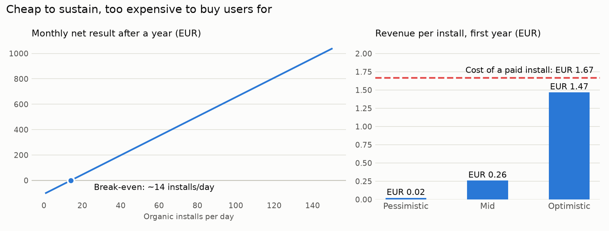

# Is a small ad-funded mobile game worth building? A unit economics model


Before writing much code for a casual mobile game I'm exploring as a side project, I wanted a number-based answer to two questions: **how many players does it need to pay for itself, and can it buy those players?** This repository holds the model I built to answer them, with every assumption sourced and adjustable.

## Answer
**Running it is cheap; buying users is not.** With mid-range assumptions:

- About **14 organic installs a day** cover the monthly costs after a year.
- A player brings in about **EUR 0.26 in their first year**, while **buying an install costs about EUR 1.67**. Paid acquisition loses money in every scenario, even the optimistic one.
- So the project lives or dies on **organic discovery**: app store search, word of mouth and social video. That is also the assumption with the weakest data behind it.

<picture>
  <source media="(prefers-color-scheme: dark)" srcset="docs/figures/unit_economics_dark.png">
  
</picture>

## What it implies for the decision
1. **Don't plan on paid growth.** Test organic pull first: store listing, short videos, a playable prototype with friends. Only consider paid acquisition if real retention turns out well above the benchmarks.
2. **Retention after a month matters more than first-day retention or pricing.** In the sensitivity analysis, D30 retention moves revenue more than any assumption except installs, while the remove-ads price barely matters.
3. **Fixed costs are not the risk.** Even the most expensive cost structure modelled breaks even at about 41 installs a day.

Full tables: [`results.md`](results.md).

## How the model works
1. **Players.** Constant daily installs and a power-law retention curve, `R(t) = D1 · t^(−b)`, fitted to pass through day-1 and day-30 retention.
2. **Ad revenue.** Active players × ad impressions per player × eCPM.
3. **Purchases.** Installs × share who buy "remove ads" × price, net of the store's 15% fee.
4. **Costs.** Monthly tooling, plus optional Spanish self-employment fees and an Apple developer account.
5. **Outputs.** Three scenarios, break-even installs per cost structure, net result by installs per day, revenue per install against the cost of buying one, and one-at-a-time sensitivity.

Every assumption has a low, mid and high value with its source in [`assumptions.json`](assumptions.json): GameAnalytics and AppAgent retention benchmarks, ad-network eCPMs, Google Play fees and others. The ones without a direct source are marked as assumptions.

## Limitations
- **Gross figures:** before tax, and the time spent building the game is not costed.
- **Installs are constant.** Real launches spike and decay.
- **Weak data on the two numbers that matter most:** organic installs per day and the cost of a paid install. Both come from industry blogs with low confidence.
- **D1 and D30 jointly shape the retention curve.** Raising D1 while holding D30 fixed makes the decay steeper, which is why higher D1 slightly lowers revenue in the sensitivity table.

## Run it
Python 3.11+, no runtime dependencies.

```bash
python src/unit_economics.py          # regenerates results.md
pip install -e ".[dev]"
pytest                                # 7 tests: retention curve, linearity, break-even, lifetime value
python docs/make_chart.py             # redraws the chart
```

To test your own scenario, edit the ranges in `assumptions.json` and rerun.
